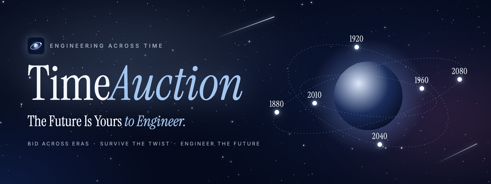

  

   
  <b>Bid across eras · Survive the twist · Engineer the future</b> 
  Developed and hosted by the <b>AI Tools &amp; Consultancy Club</b> | SAII

  
  
  

---

## What is TimeAuction?

**TimeAuction** is a live competition where players bid on the greatest inventions in history, then use them to keep humanity alive on Mars.

Every player starts with a wallet of **ChronoCoins**. Technologies from 1880 to 2080 come up for auction one at a time: the steam engine, the transistor, fuel cells, satellites, AI and more. Spend wisely: the future is about to change, and nobody knows how.

When the bidding ends, the host reveals the **Timeline Twist**: a solar superstorm, an AI recall, a crop blight, a meteor strike. Some of the tools you bought just became priceless. Others are now worth far less.

Then comes the **Future Mission**: design a system that lets people live on Mars for years, using only what you won. Judges score every solution, and the best engineers top the leaderboard.

## How a round plays

| | Stage | What happens |
|:-:|---|---|
| 🪐 | **Register** | Sign up alone or as a team of up to five. The host pairs you with 1 to 11 rivals. |
| 🔨 | **Bid** | Technologies open one by one on a ticking clock. Raise the bid, or pass. The highest bid when the clock runs out wins. |
| 🌪️ | **Adapt** | The Timeline Twist is revealed on the big screen. See what your portfolio is worth now. |
| 🛠️ | **Build** | You have five minutes to write your Mars solution from the technologies you own. |
| 🏆 | **Rank** | Judges score, check and publish the results. The leaderboard shows who engineered the future. |

## What makes it fun

- **50 technologies across 200 years.** Each match draws its own set, so no two auctions are alike.
- **30 Timeline Twists,** each with its own artwork, from *Water Crisis* to *Sky Elevator Collapse*. The twist stays secret until the host reveals it, so every bid is a gamble.
- **Wildcards and bargains.** Some lots have nothing to do with the twist, and some open at half price. Can you spot them?
- **Built for the big screen.** A projector view runs the show: rules, teams, matchups, the live auction, the twist reveal and the results.
- **Fair by design.** The event server holds every bid and every coin, and each player's station only ever sees its own side.

## How solutions are judged

Each solution gets a score out of 100 from the judges, plus or minus a few points depending on how the twist treats the technologies it uses.

| Criterion | Points |
|---|:-:|
| Mission relevance | 20 |
| Technology combination | 20 |
| Timeline Twist compliance | 20 |
| Sustainability | 15 |
| Scalability | 15 |
| Explanation | 10 |

## Built with

| | |
|---|---|
| **App** | React 19 · TypeScript · Vite |
| **Styling** | Tailwind CSS v4 |
| **Event server** | Node.js with no extra packages, live updates over Server-Sent Events |
| **Quality** | Node's built-in test runner · oxlint |

---

TimeAuction · Engineering Across Time · The future is yours to engineer.

